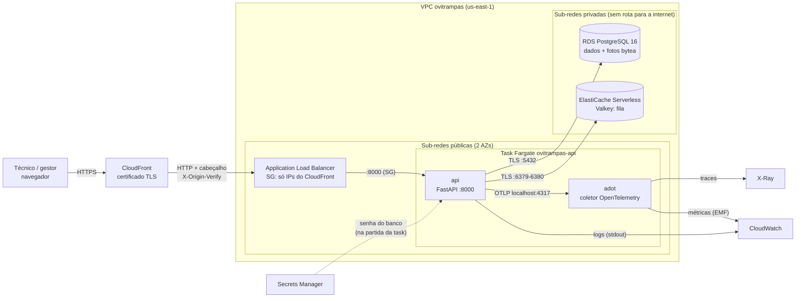
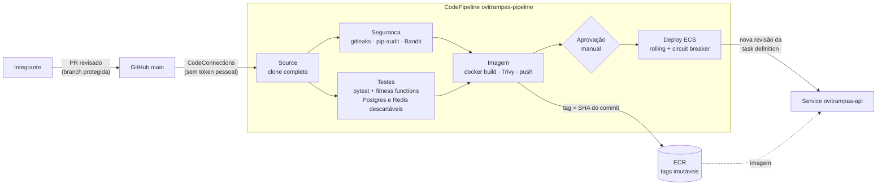

# Arquitetura de implantação na AWS

Visão de **onde cada peça roda** e **por onde passam** os pedidos, os dados, a telemetria e as mudanças de código. Complementa o C4 nível 2 (contêineres lógicos) e as ADRs 001, 006 e 007.

> O GitHub desenha os diagramas `mermaid` abaixo automaticamente. Para colar na apresentação, use o print da página no GitHub ou o site mermaid.live.

## 1. Caminho de um pedido (runtime)

**Regras de segurança visíveis no desenho:**
- A internet só chega ao **CloudFront**. O ALB só aceita IPs do CloudFront **e** o cabeçalho secreto. A task só aceita o ALB.
- Banco e fila ficam em **sub-redes privadas** e só aceitam o security group da API. Todas as conexões até eles usam **TLS**.
- Nenhuma senha está no código, na imagem ou no repositório: a do banco vem do **Secrets Manager** pela role de execução.

## 2. Caminho de uma mudança (CI/CD)

Cada caixa do pipeline é um **portão**: se falhar, nada depois dela roda. As verificações mais baratas vêm primeiro (*shift left*).

## 3. Fitness functions: qual característica cada uma protege

| Característica (AV1) | Fitness function | Onde roda | Falha quando |
|---|---|---|---|
| Segurança: segredos | gitleaks | Seguranca | qualquer segredo no histórico do Git |
| Segurança: dependências | pip-audit | Seguranca | dependência com vulnerabilidade conhecida |
| Segurança: código | Bandit `-ll` | Seguranca | achado de severidade média ou alta |
| Segurança: imagem | Trivy | Imagem | CVE crítica com correção disponível |
| Segurança: respostas | `test_erro_no_banco_nao_vaza_detalhes` | Testes | resposta de erro revela host, usuário ou exceção |
| Privacidade: telemetria | `test_spans_nao_contem_senhas` | Testes | algum span contém uma senha |
| Observabilidade | `test_ready_gera_spans_http_banco_e_fila_no_mesmo_trace` | Testes | spans do HTTP, banco e fila deixam de estar no mesmo trace |
| Disponibilidade | health check do ALB + circuit breaker | Deploy / produção | versão nova não fica saudável: rollback automático |
| Confiabilidade (contínua) | SLI de 5xx no dashboard + alarmes | produção | erros 5xx acima do limite |

## 4. O que mudou em relação à AV1

| AV1 | Agora | Por quê |
|---|---|---|
| 4 microsserviços, 3 linguagens | API única (monólito modular) + worker futuro | ADR-001: prazo e experiência do grupo |
| Kafka | Redis local / ElastiCache Valkey na AWS | ADR-001 e 007: volume pequeno; serviço gerenciado barato |
| Object Storage para fotos | fotos no PostgreSQL (`bytea`) | ADR-006 |
| App de campo | só web no MVP | ADR-003 |
| Implantação não detalhada | ECS Fargate + CodePipeline + ADOT/X-Ray | ADR-007 |
